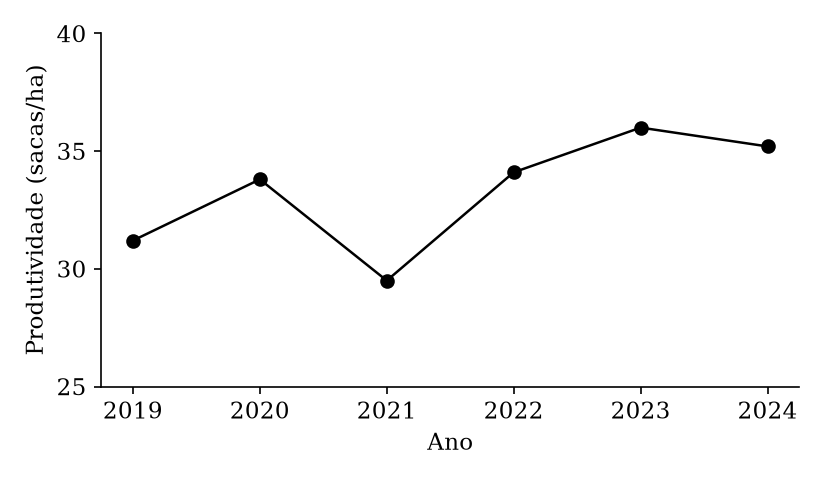

---
# =====================================================================
# Modelo de trabalho acadêmico da UFLA (manual de normalização, 6. ed.)
#
# 1. Troque os textos entre aspas pelos do seu trabalho.
# 2. Renderize no RStudio/Positron (botão Render) ou no terminal:
#      quarto render nome-deste-arquivo.qmd
# 3. Leia o terminal: avisos da extensão começam com [ufla-normas].
#
# Linhas que começam com # são comentários (desligadas). Para usar um
# campo comentado, apague o # do começo da linha.
# Guia completo: https://github.com/bonijoao/ufla-normas
# =====================================================================

# --- Tipo de trabalho --------------------------------------------------
# Define a nota descritiva da folha de rosto ("Dissertação apresentada à
# Universidade Federal de Lavras, como parte das exigências do Programa de
# Pós-Graduação em ..."). Valores aceitos (Quadro 3.1 do manual):
#   tcc, monografia, monografia-licenciatura, especializacao,
#   dissertacao, dissertacao-profissional, tese, relatorio-estagio
tipo: dissertacao

# --- Identificação -----------------------------------------------------
title: "Título do trabalho"            # a capa põe em maiúsculas
# subtitle: "subtítulo, se houver"
author: "Nome Completo do Autor"
ano: "2026"                            # ano de depósito
curso: "Agronomia/Fitotecnia"          # curso ou programa de pós-graduação
area-concentracao: "Produção Vegetal"  # opcional: apague se não houver
orientador: "Prof. Dr. Nome do Orientador"
# orientadora: "Profa. Dra. Nome da Orientadora"  # no lugar de orientador
# coorientador: "Prof. Dr. Nome do Coorientador"
# coorientadora: "Profa. Dra. Nome da Coorientadora"
# cidade: "Lavras-MG"                  # padrão: Lavras-MG

# --- Resumo e abstract (obrigatórios, de 150 a 500 palavras) -----------
abstract: |
  Este é o resumo de exemplo do modelo. O resumo apresenta, em um único
  parágrafo, o objetivo do trabalho, o método empregado, os principais
  resultados e as conclusões, com o verbo na voz ativa e na terceira pessoa
  do singular. O manual da Universidade Federal de Lavras pede de 150 a 500
  palavras para trabalhos acadêmicos, e a extensão avisa no terminal quando o
  texto fica fora desse intervalo. Neste exemplo, avaliou-se a produtividade
  do cafeeiro no sul de Minas Gerais entre 2019 e 2024, a partir de dados de
  lavouras comerciais e de séries históricas públicas. Os dados foram
  analisados por modelos de regressão e por técnicas de geoestatística,
  considerando o espaçamento de plantio, a idade das lavouras e a fertilidade
  do solo. A produtividade média variou de 29,5 a 36,0 sacas por hectare, com
  queda em 2021 associada à bienalidade e ao clima. Conclui-se que o
  espaçamento e a fertilidade explicam a maior parte da variação observada e
  que o acompanhamento anual das lavouras permite planejar melhor o manejo.
  Substitua este parágrafo pelo resumo do seu trabalho.
keywords: [Café, Produtividade, Geoestatística, Regressão]

abstract-en: |
  This is the example abstract of the template. The abstract presents, in a
  single paragraph, the aim of the work, the method, the main results and
  the conclusions, written in the active voice. The manual of the Federal
  University of Lavras requires between 150 and 500 words for academic work,
  and the extension prints a warning in the terminal when the text falls
  outside that range. In this example, coffee yield in southern Minas Gerais
  was evaluated from 2019 to 2024, using data from commercial farms and
  public historical series. The data were analysed with regression models
  and geostatistical techniques, considering plant spacing, crop age and soil
  fertility. Mean yield ranged from 29.5 to 36.0 bags per hectare, with a
  drop in 2021 associated with biennial bearing and weather. Spacing and
  soil fertility explain most of the observed variation, and yearly
  monitoring of the farms allows better planning of crop management.
  Replace this paragraph with the abstract of your work, translated from the
  Portuguese version above.
keywords-en: [Coffee, Yield, Geostatistics, Regression]

# --- Versão final (dissertação e tese) --------------------------------
# Os valores abaixo são EXEMPLOS: troque pelos reais depois da defesa.
# Enquanto o trabalho for rascunho, pode comentar estes campos: o PDF sai
# do mesmo jeito e o terminal mostra só um lembrete.
defesa: "20 de março de 2026"          # gera a folha de aprovação
banca-um-nome: "Prof. Dr. Nome do Primeiro Membro"
banca-um-inst: "UFLA"
banca-dois-nome: "Profa. Dra. Nome da Segunda Membro"
banca-dois-inst: "UFV"
# banca-tres-nome: ""                  # até quatro membros
# banca-tres-inst: ""

# Ficha catalográfica: os dados vêm da Biblioteca Universitária da UFLA.
ficha-catalografica: true
fc-autor-sobrenome: "Sobrenome, Nome Completo do Autor."
fc-tipo: "Dissertação (mestrado acadêmico)"
fc-catalogacao: "1. Café. 2. Produtividade. 3. Geoestatística. I. Sobrenome, Nome do Orientador. II. Título."
fc-classificacao: "633.73"

# Indicadores de impacto (Resolução PRPG n. 012/2024), em português e inglês.
indicadores-impacto-texto: |
  Exemplo: descreva em um parágrafo os impactos sociais, econômicos,
  tecnológicos ou ambientais do trabalho e a quem os resultados interessam.
impact-indicators-texto: |
  Example: describe in one paragraph the social, economic, technological or
  environmental impacts of the work and who benefits from the results.

# --- Elementos opcionais -----------------------------------------------
# dedicatoria: "À minha família."
# agradecimentos: |
#   Agradeço à Universidade Federal de Lavras ...
# epigrafe: "Texto da epígrafe."
# epigrafe-autor: "Autor (ano)"

lof: true      # lista de figuras
lot: true      # lista de tabelas
loq: true      # lista de quadros
siglas:        # lista de abreviaturas e siglas (sai em ordem alfabética)
  ABNT: Associação Brasileira de Normas Técnicas
  Conab: Companhia Nacional de Abastecimento
  UFLA: Universidade Federal de Lavras
# simbolos:    # lista de símbolos (na ordem escrita)
#   - "$\\alpha$": Nível de significância
# glossario:   # glossário (depois das referências)
#   Bienalidade: Alternância de safras altas e baixas no cafeeiro.

# --- Outras opções -----------------------------------------------------
# lang: en                             # trabalho em inglês (ou es); veja o guia
# titulo-traduzido: "Título em português"  # obrigatório quando lang não é pt
# formato: artigos                     # dissertação/tese em formato de artigos
# frente-verso: true                   # impressão em frente e verso

# --- Referências e formato (não mude) ------------------------------------
bibliography: referencias.bib          # seu arquivo .bib, na mesma pasta
format:
  ufla-normas-pdf: default
---

<!-- Cada "#" abre um capítulo numerado (1 INTRODUÇÃO). "##" é seção (1.1). -->

# Introdução

Este modelo mostra os recursos da extensão. Apague o texto de exemplo e
escreva o seu. A formatação segue o manual da UFLA [@ufla_manual_2025], e as
referências seguem a NBR 6023 [@abnt_nbr6023_2018].

<!--
Formas de citação (o resultado aparece no PDF):
  [@chave]               (Silva, 2020)
  @chave                 Silva (2020)
  [@chave, p. 45]        (Silva, 2020, p. 45)
  @chave [p. 45]         Silva (2020, p. 45)
  Silva [-@chave]        Silva (2020)            (só o ano)
  [ver @chave, p. 45]    (ver Silva, 2020, p. 45)
  [@chave1; @chave2]     (Santos et al., 2023; Silva, 2020)
-->

A análise de experimentos agrícolas exige planejamento [@silva_estatistica_2020].
Segundo @silva_estatistica_2020, o delineamento vem antes da coleta. A escolha
do delineamento depende da área disponível [@silva_estatistica_2020, p. 45], e
@pereira_delineamentos_2021 [p. 50] lembra que a casualização protege contra
vieses. Silva [-@silva_estatistica_2020] retoma o tema na segunda edição.

Estudos recentes avaliaram o espaçamento do cafeeiro
[@santos_produtividade_2023; @souza_modelagem_2024], e @costa_redes_2022
aplicaram redes neurais à previsão de preços [ver @costa_redes_2022, p. 5].

# Referencial teórico

A variabilidade espacial da fertilidade do solo pode ser estudada por
geoestatística [@oliveira_geoestatistica_2021]. Informações técnicas sobre a
cultura estão disponíveis na página da Embrapa [@embrapa_cafe_2024].

<!-- Citação longa (mais de três linhas): comece cada linha com ">". -->

> A citação direta com mais de três linhas fica em parágrafo próprio, com
> recuo de 4 cm da margem esquerda, letra menor que a do texto, espaçamento
> simples e sem aspas. A extensão aplica esse formato a todo bloco de
> citação escrito com o sinal de maior no começo de cada linha
> [@ufla_manual_2025, p. 60].

O @qdr-conceitos resume os conceitos usados no trabalho.

<!-- Quadro: texto organizado em células. Título acima, fonte abaixo. -->

::: {#qdr-conceitos quadro="Conceitos usados no trabalho" fonte="Elaboração própria (2026)"}

| Conceito      | Definição                                       |
|---------------|-------------------------------------------------|
| Produtividade | Produção por unidade de área (sacas/ha)         |
| Bienalidade   | Alternância de safras altas e baixas            |
| Semivariograma| Medida da dependência espacial entre amostras   |

:::

O uso de obras protegidas segue a Lei de Direitos Autorais
[@brasil_lei_1998].

# Material e métodos

Os dados de produtividade vêm das séries históricas da
@conab_safras_2026. A @fig-produtividade mostra a evolução no período, e a
@tbl-espacamento resume os tratamentos.

<!-- Figura: legenda entre colchetes, rótulo #fig-..., fonte="...". -->

{#fig-produtividade fonte="Elaboração própria (2026), com dados da Conab (2026)" width=80%}

<!-- Tabela: legenda depois da tabela, começando com ":". -->

| Espaçamento (m) | Plantas por hectare | Produtividade (sacas/ha) |
|:---------------:|--------------------:|-------------------------:|
| 3,5 × 0,5       |               5.714 |                     34,1 |
| 3,5 × 0,7       |               4.082 |                     32,6 |
| 3,5 × 1,0       |               2.857 |                     29,8 |

: Produtividade média por espaçamento de plantio. {#tbl-espacamento fonte="Elaboração própria (2026)"}

# Resultados e discussão

A produtividade caiu em 2021 (@fig-produtividade) e foi maior no espaçamento
mais adensado (@tbl-espacamento). O roteiro de coleta está no @apx-roteiro.

# Considerações finais

Escreva aqui as considerações finais. As REFERÊNCIAS entram sozinhas depois
deste capítulo, com as obras citadas no texto: não é preciso criar um título
para elas.

<!-- Apêndice: texto do autor. Para anexo (texto de outro autor), use {.anexo}. -->

# Roteiro de coleta de dados {#apx-roteiro .apendice}

Conteúdo do apêndice.
